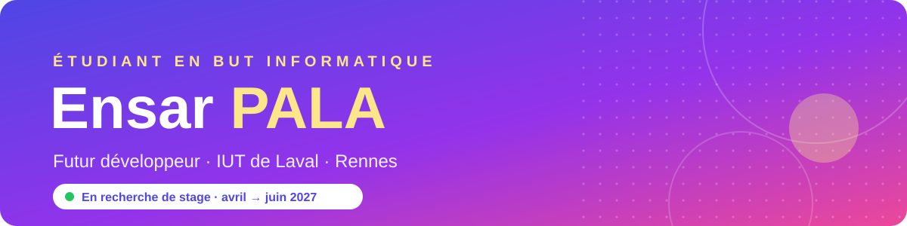

  

  

  
  
  
  
  

---

## 🎯 Je cherche un stage !

<table>
<tr>
<td align="center" width="25%">📅 <b>Quand ?</b> du 12 avril au 4 juin 2027</td>
<td align="center" width="25%">⏱️ <b>Durée</b> 8 semaines minimum</td>
<td align="center" width="25%">📍 <b>Où ?</b> Rennes et autour</td>
<td align="center" width="25%">💻 <b>Quoi ?</b> développement web, logiciel, mobile</td>
</tr>
</table>

Étudiant en **2e année de BUT Informatique** à l'IUT de Laval, je veux rejoindre une équipe pour apprendre sur de vrais projets et être utile dès le premier jour.

📫 Écris-moi : **ensar.pala.etu@univ-lemans.fr**

## 💪 Ce que je sais faire

- 🧱 Développer des applications en **Java** (JavaFX) et **Python**
- 🗄️ Concevoir des **bases de données** : modélisation MCD, requêtes, rôles et droits SQL
- 🌐 Créer des sites en **HTML, CSS et JavaScript**
- ✅ Écrire des **tests unitaires** et versionner mon code avec **Git**
- 📋 Travailler en équipe : **cahier des charges**, **GANTT**, **PERT**

## 🛠️ Mes outils

  

## 🌍 Langues
🇫🇷 Français · 🇹🇷 Turc (langues maternelles) · 🇬🇧 Anglais (B2)

  

